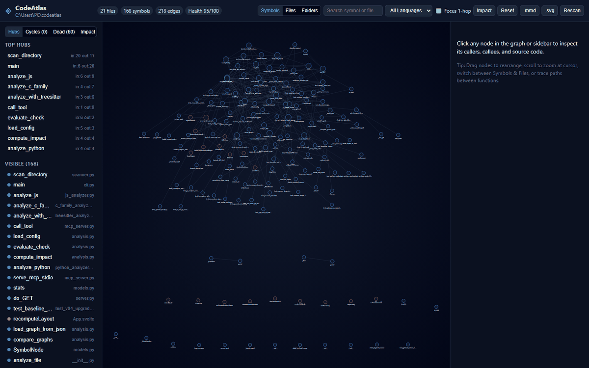
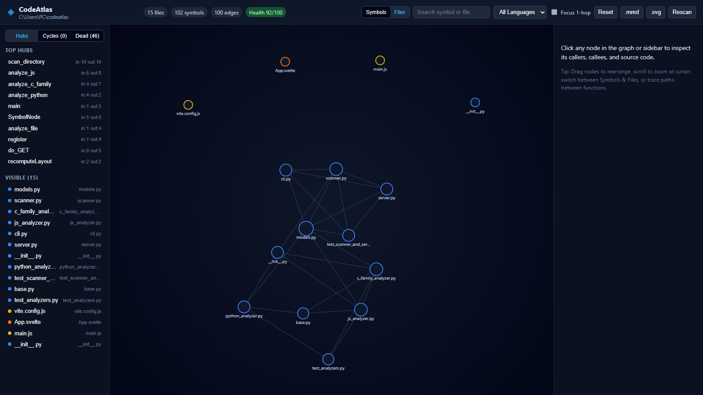
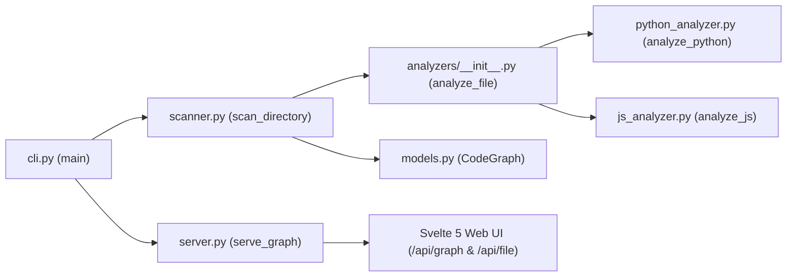

# CodeAtlas

**Zero-config local codebase architecture & call-graph visualizer.**

Inspect functions, classes, call-graph hubs, unreferenced ("dead") code, circular dependencies, and shortest call paths in your terminal or browser—with zero cloud uploads, zero configuration files, and zero runtime dependencies for the CLI.



<details>
<summary>More screenshots (Overview, Focus 1-hop, File-level Graph)</summary>

| Symbol Graph & Path Finder | Focus 1-Hop Isolation | File Dependency Map |
|---|---|---|
|  |  |  |

</details>

---

## Key Features

- **Zero Runtime Dependencies:** Pure Python standard-library CLI (`pip` / `pipx` ready).
- **Multi-Language Analysis (9 Languages):**
  - **Python:** Full `ast` parsing for classes, methods, nested functions, docstrings, relative imports, and import aliases.
  - **JavaScript / TypeScript / Svelte:** Structural analysis of functions, arrow functions, ES6 classes, methods, getters/setters, class arrow properties, and `<script>` blocks.
  - **Go / Rust / Java / C / C++:** Structural parsing of structs, traits/impl blocks, receiver methods, classes, and member call sites.
- **Architectural Health Score & Standalone HTML Report:**
  - Computes a `0–100` repository health score based on circular dependency and dead-code ratios.
  - Export self-contained single-file `.html` architecture reports (`codeatlas export . --format html -o report.html`).
- **Interactive Svelte 5 Web UI (`codeatlas serve`):**
  - Switch between **Symbol-Level** and **File-Level** dependency graphs.
  - **Hubs, Circular Dependencies (`Cycles`), and Unreferenced (`Dead`)** tabs.
  - **Shortest Call-Path Finder (BFS):** Highlight the exact call chain (`A → ... → B`) between any two symbols.
  - **Focus 1-Hop Mode:** Isolate callers and callees of the selected symbol.
  - **Live Source Preview:** Inspect exact source lines directly in the side panel.
  - **One-Click Exports:** Download `.svg` or `.mmd` (Mermaid) diagrams directly from the toolbar.
- **Fast & Scalable:** Iterative Tarjan strongly-connected-components (SCC) cycle detection, precompiled `.gitignore` matching, and automatic minified bundle filtering.

---

## Architecture Overview



---

## Installation

```bash
pip install -e .
```

## Usage

### 1. Terminal Summary (`scan`)

```bash
codeatlas .
# or explicitly:
codeatlas scan /path/to/repo
```

### 2. Interactive Web UI (`serve`)

```bash
codeatlas serve .
# Custom port / without auto-opening browser:
codeatlas serve /path/to/repo --port 4173 --no-open
```

### 3. Export Graph (`export`)

```bash
# Export as self-contained single-file HTML report
codeatlas export . --format html -o report.html

# Export as Mermaid flowchart
codeatlas export . --format mermaid -o architecture.mmd

# Export full graph analytics as JSON
codeatlas export . --format json -o graph.json
```

---

## Development & Testing

```bash
# Backend tests
pip install -e ".[dev]"
pytest -v

# Rebuild Svelte static bundle (outputs to src/codeatlas/web/)
cd frontend
npm install
npm run build
```

## License

[MIT](LICENSE)
