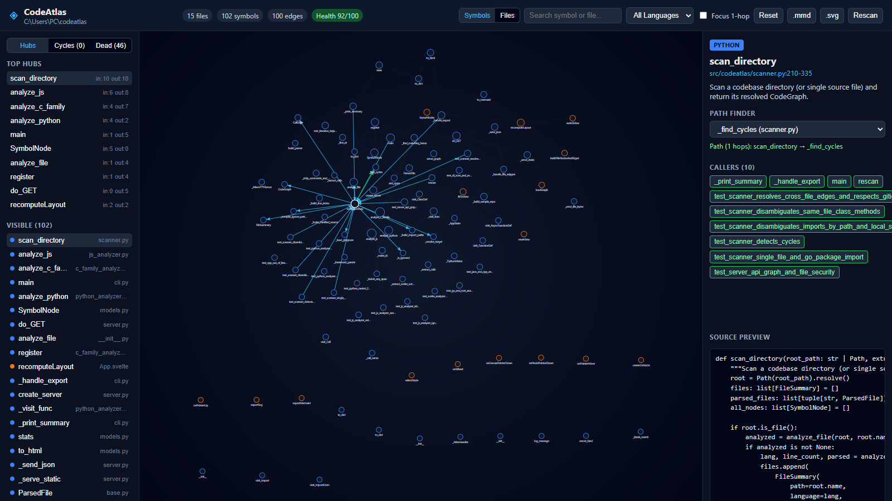
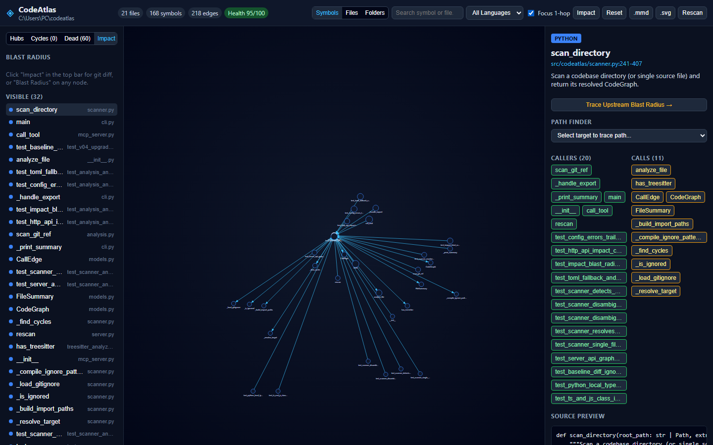
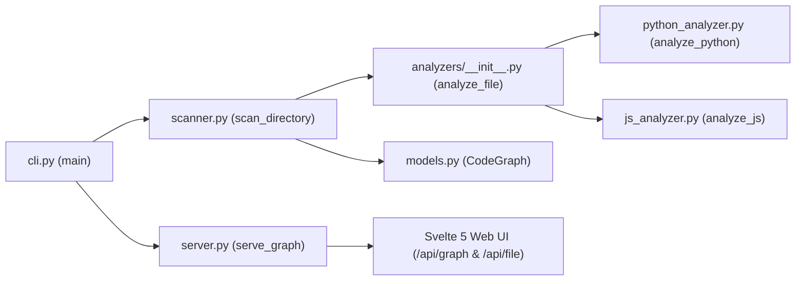

# CodeAtlas

**Zero-config local codebase architecture & call-graph visualizer.**

Inspect functions, classes, call-graph hubs, unreferenced ("dead") code, circular dependencies, and shortest call paths in your terminal or browser—with zero cloud uploads, zero configuration files, and zero runtime dependencies for the CLI.


<details>
<summary>More screenshots (Overview, Focus 1-hop, File-level Graph)</summary>

| Symbol Graph & Path Finder | Focus 1-Hop Isolation | File Dependency Map |
|---|---|---|
|  |  |  |

</details>

---

## Key Features

- **Zero Runtime Dependencies:** Pure Python standard-library CLI (`pip` / `pipx` ready), with optional `codeatlas-viz[treesitter]` extra for Tree-sitter AST parsing.
- **Multi-Language Analysis (9 Languages):**
  - **Python:** Full iterative `ast` parsing for classes, methods, nested functions, docstrings, relative imports, and import aliases.
  - **JavaScript / TypeScript / Svelte:** Structural analysis (or optional Tree-sitter AST) of functions, arrow functions, ES6 classes, methods, getters/setters, class arrow properties, and `<script>` blocks.
  - **Go / Rust / Java / C / C++:** Structural parsing (or optional Tree-sitter AST) of structs, traits/impl blocks, receiver methods, classes, and member call sites.
- **Change Impact / Blast Radius (`codeatlas impact`):**
  - Reads local `git diff` (or explicit `--file` / `--symbol` / `--diff REF`) and traces every upstream caller, affected entrypoint, and test reaching changed code.
- **CI Architecture Gate (`codeatlas check`):**
  - Enforces `--max-cycles`, `--min-health`, `--max-dead-ratio`, and module boundary rules (`--rule ui/*:db/*` or `.codeatlas.toml`) in CI pipelines.
- **Built-in Stdio MCP Server (`codeatlas mcp`):**
  - Zero-dependency Model Context Protocol server exposing call-graph, shortest-path, dead-code, and blast-radius tools to Claude Code, Cursor, or Windsurf.
- **Architectural Health Score & Standalone Exports (`export`):**
  - Computes a `0–100` repository health score and exports standalone `.html`, GitHub-flavored `.md`, `.mmd` (Mermaid), and `.json`.
- **Interactive Svelte 5 Web UI (`codeatlas serve`):**
  - Switch between **Symbol**, **File**, and **Folder Cluster** views with interactive folder drill-down and spatial grid force layout.
  - **Hubs, Circular Dependencies (`Cycles`), Unreferenced (`Dead`), and Blast Radius (`Impact`)** tabs.
  - **Shortest Call-Path Finder (BFS):** Highlight the exact call chain (`A → ... → B`) between any two symbols.
  - **Focus 1-Hop Mode, Live Source Preview, and `.svg`/`.mmd` downloads.**

---

## Architecture Overview



---

## Installation

```bash
# Run directly with pipx / uvx
pipx install codeatlas-viz

# Optional: install Tree-sitter AST backend for non-Python languages
pip install "codeatlas-viz[treesitter]"

# Or install from source
git clone https://github.com/kutyfuty/codeatlas.git
cd codeatlas
pip install -e .
```

## Usage

### 1. Terminal Summary (`scan`)

```bash
codeatlas .
# or explicitly:
codeatlas scan /path/to/repo
```

### 2. Interactive Web UI (`serve`)

```bash
codeatlas serve .
# Custom port / without auto-opening browser:
codeatlas serve /path/to/repo --port 4173 --no-open
```

### 3. Export Graph (`export`)

```bash
# Export as self-contained single-file HTML report
codeatlas export . --format html -o report.html

# Export as GitHub-flavored Markdown summary (great for PR comments / CI)
codeatlas export . --format markdown -o SUMMARY.md

# Export as Mermaid flowchart
codeatlas export . --format mermaid -o architecture.mmd

# Export full graph analytics as JSON
codeatlas export . --format json -o graph.json
```

### 4. Change Blast Radius (`impact`)

```bash
# Trace upstream callers, entrypoints & tests affected by git working-tree diff
codeatlas impact .

# Or check a specific git diff / file / symbol as Markdown (ideal for PR comments)
codeatlas impact . --diff HEAD~1 --format markdown
codeatlas impact . --symbol scan_directory
```

### 5. CI Architecture Gate (`check`) & Baseline Diff (`diff`)

```bash
# Enforce rules on the full repo
codeatlas check . --max-cycles 0 --min-health 80 --rule "src/ui/*:src/db/*"

# Baseline mode: ignore pre-existing tech debt, fail ONLY on new cycles or rule violations
codeatlas check . --baseline origin/main --max-cycles 0

# Architecture diff + PR blast-radius Markdown report
codeatlas diff . --base origin/main --with-impact --format markdown
```

Or define persistent rules in `.codeatlas.toml`:

```toml
[check]
max_cycles = 0
min_health = 80

[[rules]]
name = "UI must go through service layer"
from = "src/ui/*"
forbid = "src/db/*"
```

### 6. GitHub Action (Automated PR Architecture Comments & CI Gate)

Drop this into `.github/workflows/codeatlas.yml` to post a deduplicated Blast Radius & Architecture Diff comment on every Pull Request and block newly introduced cycles:

```yaml
name: CodeAtlas Architecture
on: [pull_request]
permissions:
  contents: read
  pull-requests: write

jobs:
  architecture:
    runs-on: ubuntu-latest
    steps:
      - uses: actions/checkout@v4
        with:
          fetch-depth: 0
      - uses: kutyfuty/codeatlas@v0.4.0
        with:
          baseline-only: "true"
          comment-on-pr: "true"
```

### 7. Built-in MCP Server (`mcp`)

Add CodeAtlas to Claude Code / Cursor / Windsurf via zero-dependency stdio JSON-RPC:

```json
{
  "mcpServers": {
    "codeatlas": {
      "command": "codeatlas",
      "args": ["mcp", "/path/to/repo"]
    }
  }
}
```

---

## Development & Testing

```bash
# Backend tests
pip install -e ".[dev]"
pytest -v

# Rebuild Svelte static bundle (outputs to src/codeatlas/web/)
cd frontend
npm install
npm run build
```

## License

[MIT](LICENSE)
